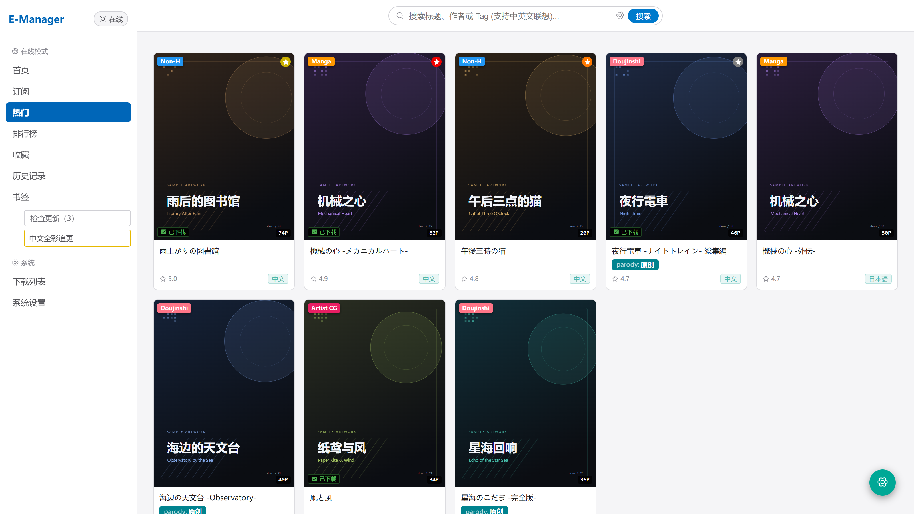
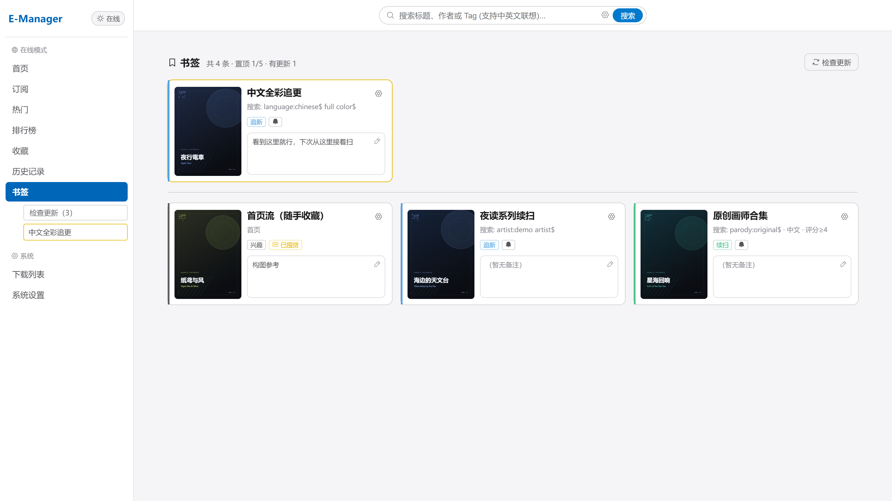
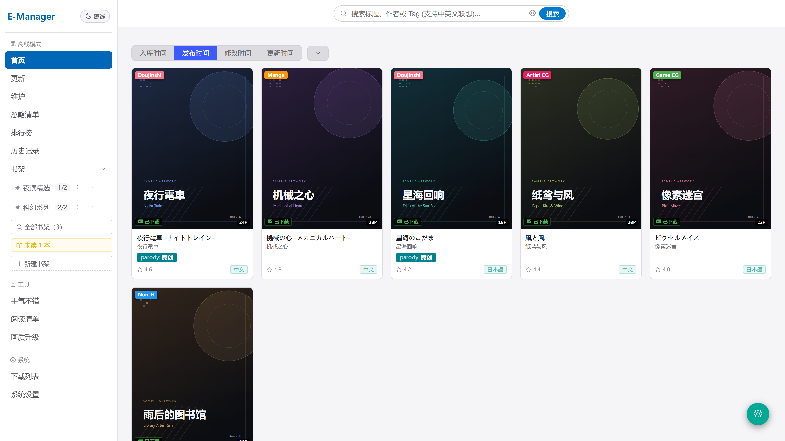
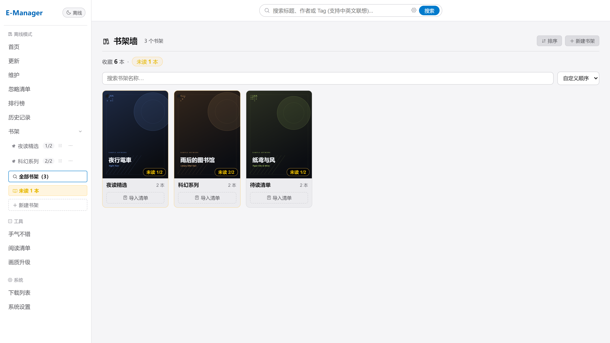
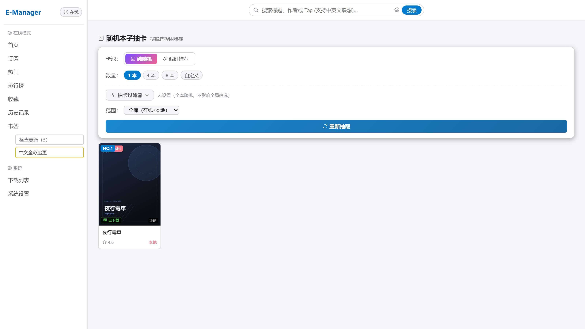
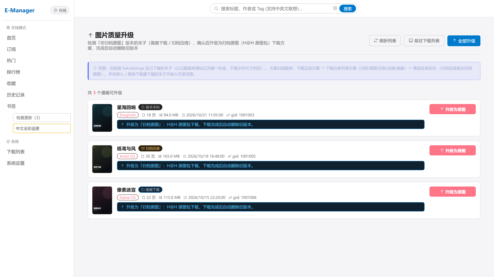
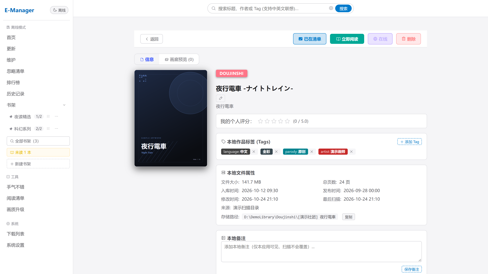
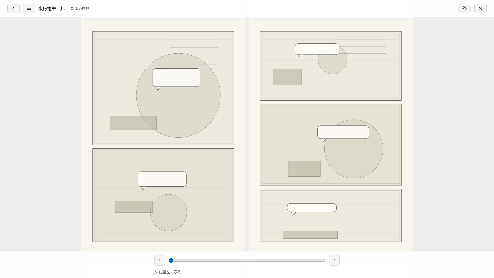

# 💡 为什么开发这个项目？

市面上的 Web 端媒体管理器界面粗糙、交互笨重；体验优异的桌面客户端又绑定单机设备，无法满足自建服务器 / NAS 用户「集中托管、随时随地访问」的需求。

SakuManga 深度优化线上线下体验、归档下载管理体验。目的在于提供完善且现代化双库联动体验，并让屯屯鼠用户能够便利地囤积、管理本地画廊

---

# ⭐项目优势

sakumanga有以下优势：
1. 人性化书签界面：
	- **精心设计的书签页面：** 每个书签项都可单独配置“订阅更新”、“备注”、“书签名称”，且能够记录书签锚定的画廊封面。让每次搜刮都更加便捷，不需要担心记不住上次的搜刮位置、画廊的搜刮进度
	- **智能的搜刮提醒：** 通过订阅书签，sakumanga会在每天指定时间点检测书签所在搜索页是否存在更新，并告知用户进行搜刮。避免每次点进去却发现无事发生
	- **便利的标签标记：** 书签支持**追新**、**兴趣**、**续扫**三种类别并显示标注

2. 深度优化下载体验：提供进阶网络配置，支持与clash联动。告别频繁的下载报错，再也不用担心睡前下载百余本，起床出错九十本的痛苦体验（需要在设置中开启）

3. 一键切换本地仓库：通过顶部按钮一键切换到本地仓库，体验齐备的维护、自动更新、随机抽卡功能。再也不用担心EhentaiViewer与本地管理器割裂的问题

4. 智能化本地管理：
	- **更新功能：** 支持每周自动扫描查询画廊更新、自动下载和替换本地画廊（需要在设置中开启）。并且自动旧化画廊，防止超过1年没更新的画廊继续占用更新份额
	- **升级功能：** 自动检测本地仓库中经由sakumanga下载的画廊版本本子，便于快速更新画廊画质到归档
	- **维护功能：** 支持父子画廊关系精准扫描、重复项模糊匹配，用户也可以通过屏蔽错报画廊防止误报
	- **书架&阅读清单：** 支持创建多个本地书架，并且一键导入阅读清单，快速阅读系列本子。同时支持显示书架中的未读本数，缓解选择困难症与书架落灰的问题。
	- **词云&随机抽卡：** 基于阅读频次和本地仓库本子分布生成的XP词云，更便于快速筛选想要用的tag类型。而随机抽卡联动XP词云，从库藏/阅读、探索率、采样温度等多个方面客制化每次的抽卡结果，让抽卡结果更懂你。

5. 客制化本子管理：
	- **屏蔽本子：** 支持屏蔽本子指定页面，再也不用担心多语言画廊长时间翻不到需要的语言界面
	- **智能Tag管理：** 用户可以删除、增加相关tag，并且每日定时更新本子画廊的tag，始终与在线保持一致

6. 高级阅读器界面：
	- **章节配置：** 可以自行配置不同的章节分段，让合集、长连载本子读起来更便捷。
	- **单页收藏：** 可以自行收藏单页，记录下最戳XP的内容

---
# 🖼️ 预览图

## 在线热门


## 书签界面


## 离线界面


## 书架界面


## XP词云


## 随机抽卡


## 升级界面


## 离线详情页


## 阅读界面


---

# ✅ 当前状态

> [!NOTE]
> **项目更新状态（Project Status）**  
> 历史版本的更新状态见 [CHANGELOG.md](CHANGELOG.md)（跨版本一览）；本版发布详述见 [DSPlans/VerNotes/RELEASE_NOTES_v2.3.0.md](DSPlans/VerNotes/RELEASE_NOTES_v2.3.0.md)。

> [!NOTE]
> **v2.3.0**（2026-10）**搜刮书签重做 + 下载链路升级**：
> 
> 升级
> - **书签升级为独立页面：** 三列卡片墙，每张卡固定四区
> - **书签升级：** 新增3种书签标记、支持自定义备注、支持自动检查更新
> - **高级代理设置（管理员）：** 可对接本机 Clash / mihomo 控制面，按站点指定代理组；归档下载失败时自动换节点重试，重试时切回原节点以**省 GP 重复扣费**。
> - **Phosphor 矢量图标：** 全站约 550 处 emoji 与字符符号替换为 Phosphor 矢量图标，优化视觉体验
> 
> 修复
> - **优化下载链路：** 排队任务不再卡死
> - **优化降级判定：** 网络抖动不再固化为降级、普通下载归档失败不再静默降级为画廊
> - **订阅页请求路径修正：** 改为 `/watched`，请求异常时不再静默退回首页。

# 🗺️ 后续计划

**多端适配** —— 统一桌面 / iPad / 手机三端的布局与交互，收敛 PWA 与触摸场景下的适配问题

继续优化**线上搜刮体验**：

- **在线本地比对**：在线列表 / 详情直接呈现「本地是否已有」，避免重复下载、方便补齐缺失
- **同名本子找其他语言版本**：按标题 / 元数据匹配同名作品，一键找到同一本子的其它语言版本（含已入库与线上）
- **其余小功能优化**：按实际使用体验随时调整，暂无固定排期

长期方向延续稳定性与体验主线：抽卡负向排除的后端采样补位、离线端更丰富的检索与维护能力、下载稳定性与资源占用收敛、跨设备进度同步与多用户协调。

---
# 🌲 [项目结构图](PROJECT_TREE.md)


---
# 🚀 构建与运行

**一键打包（单文件 exe：前端 + 后端 + 系统托盘）：**

```bat
build-release.bat
```

生成 `SakuManga.exe`：双击运行后最小化到系统托盘，右键托盘图标可选「打开界面 / 退出程序」；默认监听 `http://127.0.0.1:8081`，首次启动自动创建管理员 `admin/admin123`。打包脚本标题与前端「关于」页版本号均自动读取 `package.json`，发版只需修改一处。

**纯后端运行（NAS / 无界面环境）：**

```bat
SakuManga.exe --headless
```

**Docker 部署（NAS / Linux 长期运行，自 v2.1.1 起提供官方镜像）：**

```bash
docker run -d --name sakumanga --restart unless-stopped \
  -p 8081:8081 \
  -v /your/data/dir:/app \
  ghcr.io/yeonalbus/sakumanga:2.2.0
```

镜像同时提供 `linux/amd64` 与 `linux/arm64`（群晖 / 树莓派 / Apple Silicon 均可直接运行），标签策略为 `2.2.0` / `2.2` / `latest`。数据（`manga.db` / `config.json` / `data/` / `logs/`）全部保存在挂载目录，升级 = 换镜像标签重建容器。推送 `SakuManga-X.Y.Z` tag 时由 GitHub Actions 自动构建发布，也可在仓库 Actions 页面手动触发；本机想自己构建用 `build-docker.bat`。完整说明见 [`DSPlans/VerNotes/wiki.md`](DSPlans/VerNotes/wiki.md)「九、Docker 部署」。

**开发模式：**

```bat
npm install
cd backend && go run .        # 后端 http://127.0.0.1:8081
npm run dev                   # 前端开发服务器（Vite 代理到后端 API）
```

> 后端 `//go:embed all:dist` 编译必需 `backend/webui/dist`（前端构建产物，随仓库维护）：前端改动后请执行一次 `npm run build` 并将根目录 `dist/` 拷贝到 `backend/webui/dist`，或直接运行一次 `build-release.bat`。

---

# 📄 开源协议与致谢

## 致谢 / Acknowledgements

本项目在开发过程中借鉴与使用了以下优秀的开源项目及社区资源：

- **[JHentai](https://github.com/jiangtian616/JHenTai)**：感谢其在界面交互与部分业务逻辑实现上提供的灵感与思路。
- **[EhTagTranslation](https://github.com/EhTagTranslation/Database)**：本项目的标签汉化与翻译数据库来源于 EhTagTranslation 社区。
- **[e-hentai-tag-count](https://github.com/mokurin000/e-hentai-tag-count)**：本项目的标签联想来源于 e-hentai-tag-count 社区。

## 数据协议说明 (EhTagTranslation)

本项目集成的标签数据库内容由 **EhTagTranslation** 贡献者共同维护，数据依据 **[CC BY-NC-SA 3.0](https://creativecommons.org/licenses/by-nc-sa/3.0/deed.zh)**（署名-非商业性使用-相同方式共享 3.0）协议提供：

- **非商业性**：本项目及标签数据仅供个人学习与交流使用，严禁任何形式的商业盈利行为。
- **署名与共享**：对标签数据的二次分发或衍生使用均继承原协议条款。

## 开发者说明 / Notes

- **AI 辅助生成**：本项目的架构设计与绝大部分代码由 AI 辅助编写与重构。
- **测试状态**：项目可能存在未覆盖的边缘场景或缺陷，欢迎提交 Issue 或 PR 协助完善。

## 开源协议 / License

本项目采用 [AGPL-3.0 License](LICENSE) 开源。
